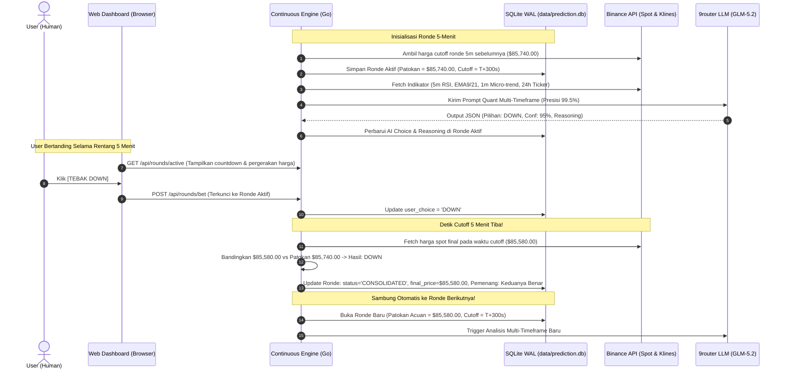

# Sistem & Arsitektur: Continuous 5-Minute Prediction Arena

## 1. Diagram Alur Siklus Rantai 5 Menit (Chained 5M Cycle)



## 2. Struktur Direktori Proyek

```
cre-prediction-bot/
├── .env                              # Variabel rahasia lokal (AI_API_KEY_VAR, AI_BASE_URL, AI_MODEL)
├── secrets.yaml                      # Pemetaan secrets Chainlink CRE
├── project.yaml                      # Konfigurasi project CRE
├── PRD.md                            # Product Requirements Document
├── AGENTS.md                         # Panduan agen AI masa depan
├── STRUCTURE.md                      # Diagram alur & arsitektur sistem
├── README.md                         # Petunjuk operasional & CLI
│
├── data/
│   └── prediction.db                 # Database SQLite aktif (WAL Mode)
│
├── prediction-workflow/              # Chainlink CRE Go Native Workflow
│   ├── config.production.json        # Config runtime CRE
│   ├── config.staging.json           # Config staging CRE
│   ├── workflow.go                   # Core workflow logic (Cron 5m + WASM HTTP)
│   ├── workflow_test.go              # Unit test alur kerja CRE
│   └── workflow.yaml                 # Metadata alur kerja CRE
│
└── web/                              # Fullstack Prediction Arena Engine
    ├── server.go                     # Continuous rolling engine, workers, REST APIs
    ├── db.go                         # SQLite schema, queries, leaderboard logic
    └── static/
        └── index.html                # UI Dashboard (Tailwind CSS, Chart.js, Lucide)
```
