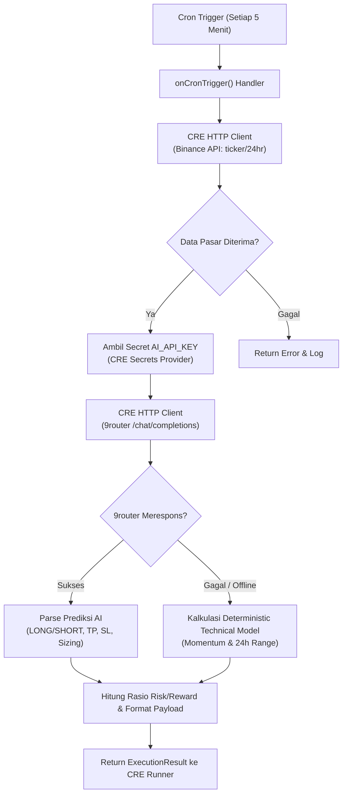

# Project Structure & Architecture: CRE 5-Minute Binance Prediction Bot

## 1. Peta Direktori & File

```text
cre-prediction-bot/
├── .env                                  # Kredensial privat lokal (AI_API_KEY_VAR, dsb.)
├── .gitignore                            # Mengabaikan file sensitif, wasm, dan binary
├── project.yaml                          # Konfigurasi level proyek CRE (RPC & targets)
├── secrets.yaml                          # Pemetaan ID secret CRE ke environment variable
├── go.mod                                # Definisi modul Go dan dependensi SDK CRE
├── go.sum                                # Checksum dependensi Go
├── PRD.md                                # Product Requirements Document
├── AGENTS.md                             # Panduan agen AI & pemeliharaan teknis
├── STRUCTURE.md                          # Dokumentasi arsitektur dan struktur file
├── README.md                             # Ikhtisar umum & panduan mulai cepat
└── prediction-workflow/                  # Direktori workflow utama
    ├── main.go                           # Entry point WASM runner (wasip1 build tag)
    ├── workflow.go                       # Logika inti: Cron trigger, HTTP fetch, AI inference, fallback
    ├── workflow_test.go                  # Unit test Go untuk logika prediksi dan trigger
    ├── workflow.yaml                     # Konfigurasi target CRE (staging & production)
    ├── config.staging.json               # Parameter target staging (simulasi)
    └── config.production.json            # Parameter target produksi
```

---

## 2. Diagram Alur Data (Data Flow)



---

## 3. Komponen Arsitektur Utama

### 3.1. `prediction-workflow/main.go`
Berfungsi sebagai gerbang eksekusi *WebAssembly* (`wasip1`).
```go
//go:build wasip1
package main

import (
	"github.com/smartcontractkit/cre-sdk-go/cre"
	"github.com/smartcontractkit/cre-sdk-go/cre/wasm"
)

func main() {
	wasm.NewRunner(cre.ParseJSON[Config]).Run(InitWorkflow)
}
```

### 3.2. `prediction-workflow/workflow.go`
Modul utama yang mencakup:
- **`InitWorkflow`**: Menginisialisasi `cron.Trigger(&cron.Config{Schedule: schedule})`.
- **`onCronTrigger`**: Mengeksekusi siklus 5-menit, memanggil Binance API via `creHttp.SendRequest`, mengekstrak kunci API, mengevaluasi AI via 9router, dan membungkus hasil dalam `ExecutionResult`.
- **`queryAIOrFallback`**: Melakukan inferensi prompt AI dan melakukan *fallback* aman jika endpoint AI tidak merespons.
- **`computeTechnicalPrediction`**: Menghitung arah posisi, target harga, batas risiko, dan ukuran posisi berdasarkan momentum pergerakan harga 24 jam.

### 3.3. `prediction-workflow/workflow.yaml`
Menghubungkan target eksekusi CLI (`staging-settings`, `production-settings`) ke file konfigurasi JSON dan `secrets.yaml`:
```yaml
staging-settings:
  user-workflow:
    workflow-name: "prediction-workflow-staging"
    deployment-registry: "private"
  workflow-artifacts:
    workflow-path: "."
    config-path: "./config.staging.json"
    secrets-path: "../secrets.yaml"
```
